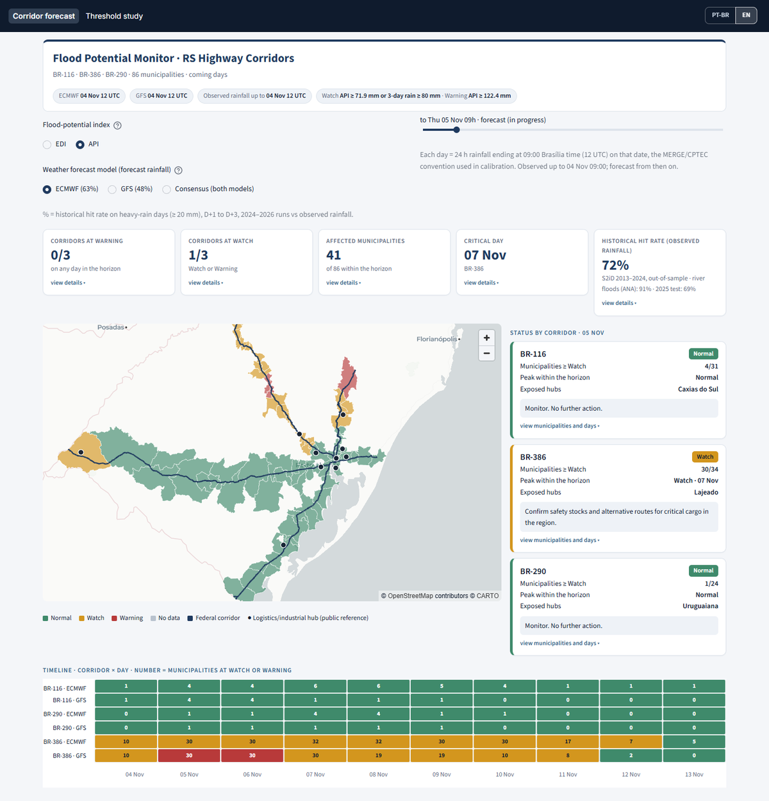
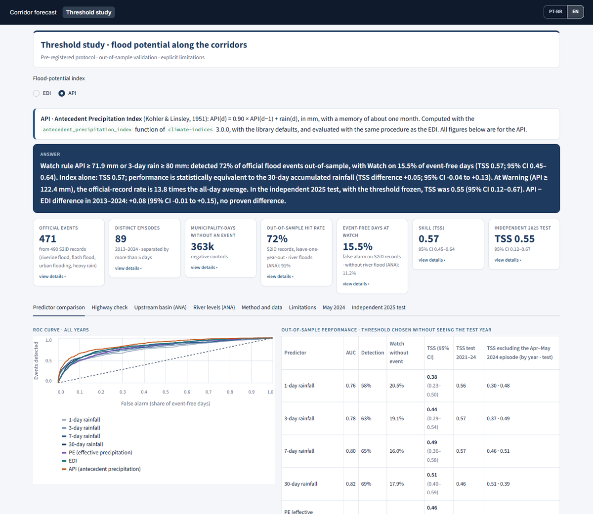
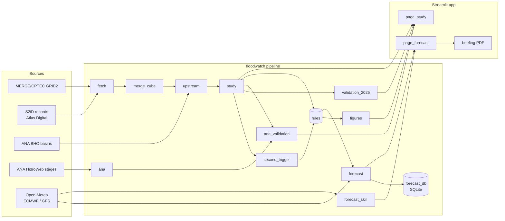

# RS Corridor Flood Watch

**Flood-potential early warning for the federal road corridors BR-116, BR-386 and BR-290 in Rio Grande do Sul, Brazil.
Two antecedent-rainfall indices (EDI and API) are calibrated on official disaster records, validated out of sample and
against gauged river floods, then applied every day to ECMWF and GFS forecasts.**



The April–May 2024 floods cut the main road links of Rio Grande do Sul for weeks. Beyond the human toll, they disrupted
water, power, transport and the supply chains that depend on the state's highways. This project asks one operational
question:

> *Can a rainfall-based antecedent-wetness index tell, days ahead, when the municipalities along the main logistics
> corridors are in conditions that have historically produced flood records?*

The answer is a cautious yes, with explicit limits. Every threshold was chosen on data the test never saw, every
headline number carries a 95 % confidence interval, and every decision taken after seeing a result is logged in
[docs/protocol.md](docs/protocol.md).

---

## Contents

1. [Key results](#key-results)
2. [Dashboard](#dashboard)
3. [Scientific method](#scientific-method)
4. [Software architecture](#software-architecture)
5. [Run it](#run-it)
6. [Limitations](#limitations)
7. [Data sources and licence](#data-sources-and-licence)

---

## Key results

All numbers use **observed** rainfall (MERGE/CPTEC). Unit = municipality-day in the 86 corridor municipalities,
2013–2024. Events = **471** official flood events (490 S2iD records, 89 independent episodes); controls = 362,614
municipality-days without an event. TSS (Peirce skill score) = detection − false-alarm rate; 0 = no skill, 1 = perfect.

### Out-of-sample skill (leave-one-year-out, thresholds fitted without the tested year)

| Rule | AUC | Detection | False alarm¹ | TSS (95 % CI) | Train 2013–20 → test 2021–24 |
|---|---|---|---|---|---|
| **API, dashboard rule** (API ≥ 71.9 mm **or** 3-day rain ≥ 80 mm) | 0.86 | 72 % | 15.5 % | **0.57** (0.45–0.64) | 0.59 |
| **EDI, dashboard rule** (EDI ≥ 1.26 **or** 3-day rain ≥ 61 mm) | 0.82 | 75 % | 23.4 % | **0.52** (0.42–0.59) | 0.52 |
| EDI alone | 0.82 | 71 % | 21.8 % | 0.49 (0.38–0.57) | 0.50 |
| 30-day accumulated rainfall (benchmark) | 0.82 | 69 % | 17.9 % | 0.51 (0.40–0.59) | 0.46 |
| 3-day accumulated rainfall (benchmark) | 0.78 | 63 % | 19.1 % | 0.44 (0.29–0.54) | 0.57 |

¹ Share of event-free municipality-days on which the level was at Watch or above.

- **Warning level** (index above the value exceeded on only 2 % of event-free days): the flood-record rate is
  **13.8×** the all-day average for the API (≥ 122.4 mm) and **7.6×** for the EDI (≥ 3.16).
- **API vs EDI:** +0.08 TSS (95 % CI −0.01 to +0.15). The API is ahead but the gain is **not proven** on the official
  records. Against gauged river floods it **is**: +0.14 (+0.07 to +0.23).
- **Indices vs plain rainfall:** neither index beats 30-day rainfall with statistical confidence (API +0.05, CI −0.04 to
  +0.13; EDI −0.02, CI −0.11 to +0.05). This is reported as a result, not hidden.
- **3-day trigger:** adding "or 3-day basin rain ≥ b" improves the EDI (+0.03, CI +0.007 to +0.06, leave-one-year-out)
  and makes a negligible difference for the API. It is part of the dashboard rule for both.
- **Upstream-basin rainfall vs rainfall over the municipality:** equivalent on the official records (EDI −0.01,
  API +0.01, both CIs include 0) and slightly better against river floods. Basin rainfall is used because it is the
  rainfall that fills the rivers, not because it was proven better.

### Independent tests (thresholds frozen, nothing re-tuned)

| Test | EDI | API |
|---|---|---|
| **2025 records** (68 events, 12 episodes; a year no stage of the study used) | TSS 0.23 (0.03–0.55), detection 37 % | TSS 0.55 (0.12–0.67), detection 69 % |
| **Gauged river floods**, ANA (32 gauges, 25 municipalities, 257 events), dashboard rule | detection 91 %, false alarm 19.1 %, TSS 0.72 | detection 91 %, false alarm 11.2 %, TSS 0.80 |
| **Documented road impacts** on the three highways (16 evaluated) | 16/16 at Watch or above on D−2…D, 9 at Warning | 16/16 at Watch or above, 12 at Warning |

The pre-registered 2025 criterion (lower CI bound of TSS above 0.2) was **not met by either index**. Most 2025 events
came from the June flood, which followed a drought: the 365-day memory of the EDI was still low when intense rain
arrived, while the API (about one month of memory) reacted faster.

### Forecast rainfall

Archived runs, March 2024 → November 2026, 34 boxes of 0.5° over the corridors. ECMWF IFS forecast heavy rain
(≥ 20 mm/day, D+1 to D+3) better than NOAA GFS: equitable threat score 0.345 vs 0.286 (difference +0.059, 95 % CI
+0.026 to +0.093). Both underestimated 3-day rain on flood-record days (ECMWF 69 %, GFS 61 % of the observed amount at
D+1). **The skill of the levels computed with forecast rainfall has not been measured yet**; every forecast is archived
so that it can be (see [Forecast archive](#forecast-archive)).

---

## Dashboard

Streamlit, two pages, Portuguese and English (`?lang=en`), light corporate theme, desktop and mobile layouts.

### Page 1 — Corridor forecast

- **Selectors:** flood-potential index (EDI or API) and weather model (ECMWF, GFS, or consensus = the lower level of
  the two), each with an explanation.
- **Day slider:** each day is the 24 h window ending at 09:00 Brasília time (12 UTC), labelled *observed*,
  *forecast (in progress)* or *forecast*.
- **Header badges:** model run times, last observed day and the rule in force (Watch / Warning thresholds and 3-day trigger).
- **KPI cards** that open on click: corridors at Warning and at Watch, affected municipalities, critical day, and
  historical skill. The skill card shows the same rule scored against S2iD records and against gauged river floods.
- **Map** (pydeck): municipality levels for the selected day, the three highways and public logistics references,
  with tooltips.
- **Per-corridor cards** with the municipalities at Watch or Warning, a recommended action per level, an alert feed
  and a corridor × day timeline for both models.
- **Forecast vs observed**, updated every day: the latest verified day per model (forecast vs observed rainfall, municipalities
  at Watch forecast vs observed, false alarms and misses by name) and the accumulated detection, unconfirmed alarms and
  rainfall bias by lead time. *Observed* = the same rule computed later with MERGE rainfall.
- **Reported floods vs forecast:** every flood reported in a corridor municipality on a verified day, with the forecast
  level and the level with observed rain. Official S2iD records are used where an official release covers the date;
  after that, preliminary reports (Civil Defence bulletins, press) from `data/raw/reports/preliminary_reports.csv`.
  A new official release is detected and loaded automatically.
- **Model verification** panel: which model forecast heavy rain better, by lead time (archived runs 2024–2026).
- **Executive briefing (PDF, A4, two pages):**
  - *page 1:* bottom line per corridor, map, municipalities to watch, logistics references, model agreement and
    reliability;
  - *page 2:* the coming days, one row per 24 h window, with ECMWF/GFS rainfall, corridor levels, municipalities at
    Warning and a rainfall chart.

### Page 2 — Threshold study



- **Answer banner** and KPI cards (events, controls, out-of-sample detection, false alarms, TSS, 2025 test), each with
  details. The index selector switches every number between EDI and API.
- **Tabs:**
  - *Predictor comparison:* ROC curves, the out-of-sample table and paired comparisons.
  - *Highway check:* documented road impacts.
  - *Upstream basin (ANA):* municipal vs basin rainfall.
  - *River levels (ANA):* the same rule against S2iD records and against river floods.
  - *Method and data*, *Limitations*, *May 2024* timeline, *Independent 2025 test* (including the second-trigger test).

---

## Scientific method

The full, consolidated protocol with the decision log is in [docs/protocol.md](docs/protocol.md). Summary:

### Data

| Input | Source | Use |
|---|---|---|
| Daily rainfall | MERGE/CPTEC-INPE, 0.1°, V07B final 1998–2024; IMERG late/early afterwards (product version checked per day) | Indices and accumulations |
| Flood events | S2iD records compiled in the Atlas Digital de Desastres no Brasil (MIDR/CEPED-UFSC, DB v1.1), COBRADE 12100, 12200, 12300, 13214 | Calibration and validation |
| Basins | ANA Otto-coded basins (BHO 2017, level 6) | Upstream-basin rainfall |
| River stages | ANA HidroWeb | Independent validation and river-state predictor |
| Roads, municipalities | DNIT SNV 2024, IBGE | Corridor municipalities (≥ 0.5 km of road) |
| Forecast | ECMWF IFS and NOAA GFS 12 UTC deterministic runs via Open-Meteo (CC BY 4.0) | Daily forecast |

### Unit: the upstream basin

A river rises with the rain over its whole basin, not only over the municipality. For each municipality the rainfall
is the area-weighted mean over the level-6 Otto-coded basins with ≥ 5 km² inside it, plus every basin upstream of them
(Pfafstetter rule: a basin is upstream if its code is greater and shares the prefix up to the last even digit).
Coastal and lagoon codes (all digits odd) have nothing upstream but themselves. A day is valid only when ≥ 99 % of
the area has data.

### Indices (official library implementations, no adaptation)

- **EDI**, Effective Drought Index (Byun & Wilhite, 1999): effective precipitation over 365 days, standardised per
  calendar day with calibration fixed to 1999–2012 (disjoint from the evaluation years). `climate-indices` 3.0.0
  `effective_precipitation` + `edi`, library defaults.
- **API**, Antecedent Precipitation Index (Kohler & Linsley, 1951): `API(d) = 0.90 · API(d−1) + P(d)`, in mm; rain
  from 7 days ago still weighs ~48 %, from 30 days ~4 %. `antecedent_precipitation_index`, zero seed, a missing day
  propagates as missing. k = 0.90 is within the range cited by the library (0.85–0.90).
- The index code refuses any other library version.

### Events and samples

- Records of one municipality within 7 days are chained into one event, dated by its first record. Events of any
  municipality chained with gaps of ≤ 5 days form an episode, the bootstrap unit.
- Controls are municipality-days more than 15 days away from any record.
- The predictor value on day d is the maximum of d−1 and d. This absorbs the 12–12 UTC rainfall window and ±1 day in
  the reported date.

### Threshold selection and validation

- **Watch** = the threshold that maximises TSS on the training years. **Warning** = the lowest value exceeded on at most
  2 % of event-free days.
- **Leave-one-year-out** (primary) and a **temporal holdout** (2013–2020 → 2021–2024).
- **Block bootstrap** for every confidence interval: positives resampled by episode, controls by year-month, 2,000
  replicates, fixed seed.
- **Paired comparisons:** a rule "improves" only if the whole 95 % CI of the paired TSS difference lies above 0.
- **Final thresholds** are refitted on all 2013–2024 years and frozen.

### Dashboard rule (`floodwatch/rules.py`)

| Level | Condition |
|---|---|
| Warning | index ≥ Warning threshold |
| Watch | index ≥ Watch threshold, **or** 3-day basin rainfall ≥ frozen trigger |
| Normal | otherwise |
| No data | index missing (never shown as Normal) |

A corridor takes the highest level present in at least 20 % of its municipalities on that day. This is a display
rule and was not validated.

### Rigour safeguards

- **Pre-registration:** each analysis (2025 test, model verification, upstream basin, rivers, second trigger) was
  written into the protocol before it was run. Post-hoc decisions are labelled as such in the decision log.
- **No re-tuning on test data:** 2025, river floods and road impacts are only ever scored with frozen thresholds.
- **Negative results are published:** the indices do not beat 30-day rainfall with confidence, and the 2025 criterion
  was not met.
- **Provenance:** every download has a sibling `.http.json` (URL, time, size, SHA-256). The MERGE product version is
  checked per day, and only V07B final is used for 1998–2024.
- **Reproducibility:** pinned dependencies, fixed seeds, and a runbook that rebuilds every number from raw data.
- **One implementation of each rule:** statistics (`stats.py`), the operational rule (`rules.py`) and the GRIB reader
  (`merge_cube.read_grid`) each exist once, so the study, the forecast and the dashboard cannot drift apart.

---

## Software architecture



### Modules (`floodwatch/`)

| Module | Responsibility |
|---|---|
| `paths` | Every file location in one place |
| `fetch` | Downloads raw inputs (MERGE, Atlas, IBGE, DNIT) with provenance files |
| `merge_cube` | The single checked GRIB2 reader (variable, date, grid, origin, scan order, product state); area means; RS cube |
| `upstream` | Pfafstetter upstream masks, basin weights, basin rainfall (observed) and the 0.25° forecast grid |
| `indices` | EDI, PE and API from `climate-indices` 3.0.0, with an explicit calendar and calibration |
| `stats` | Contingency scores, AUC, threshold search, folds, block bootstrap, paired differences |
| `study` | Units, events and samples; predictors; out-of-sample evaluation → `results.json` |
| `second_trigger` | Index OR 3-day rain rule, fitted per fold; frozen trigger → `second_trigger.json` |
| `rules` | The operational rule (Normal / Watch / Warning / No data) used by every consumer |
| `validation_2025` | Independent 2025 test with frozen thresholds |
| `ana`, `ana_validation` | HidroWeb download and daily stages; basin vs municipal; river-flood validation; river-state predictor |
| `figures` | Derived tables for the study page (ROC, risk multiplier, May-2024 timeline, leads, road check) |
| `forecast_skill` | ECMWF vs GFS verification against MERGE, pre-registered |
| `forecast` | Daily run: refresh MERGE, basin rainfall, ECMWF/GFS 12 UTC runs (paced requests), apply the rules |
| `forecast_db` | SQLite archive of every run (schema in `sql/`), observed vs forecast verification views, `verification.json` |
| `official_records` | Weekly check of the Atlas Digital download page for a new S2iD release (auto-loaded); preliminary flood reports |
| `page_forecast`, `page_study`, `briefing`, `ui_theme`, `exposure` | Streamlit pages, the PDF briefing, the shared visual system and public logistics references |

### Data layout

```
data/raw/          spatial, road_impacts (in git); merge, atlas, ana, forecast_api (downloaded, not in git)
data/processed/
  study/           results.json, second_trigger.json, validation_2025.json, upstream_results.json,
                   river_validation.json, river_predictor.json, figure tables, units.geojson, basin rainfall
  forecast/        runs/<utc>/ (metadata.json + municipal_levels.csv), latest.json, forecasts.sqlite (local)
sql/               schema.sql (tables + verification views), validation.sql (ready-made queries)
docs/              protocol.md, runbook.md, data-sources.md
tests/             focused tests for the rules behind the published numbers
```

### Forecast archive

Every daily run is ingested into SQLite (`runs`, `municipal`, `corridor`, `events`). Each run stores the rule it used
and the last observed days, so later runs verify earlier forecasts. The `verification` view pairs each forecast with
the observed value and with official records, once these are loaded. `sql/validation.sql` has the queries, and
`python -m floodwatch.forecast_db report` prints them. After each run, `forecast_db.write_summary` exports the comparison to
`data/processed/forecast/verification.json`, which is published with the run and shown on the forecast page. This is how
the levels computed from forecast rainfall are verified prospectively, from November 2026 onwards.

### Quality

- `pytest -q`: 15 focused tests, covering block bootstrap and scores, event chaining, the 12 UTC window, the rule and
  trigger, rule compatibility with older runs, the Pfafstetter upstream rule, basin means, GRIB cropping, EDI
  calibration, API recursion and missing days, forecast-verification counts, preliminary-report filtering, and module reachability.
- `pyflakes` clean. External requests are paced, honour `Retry-After` and never retry aggressively.

---

## Run it

```bash
python -m venv .venv && .venv/Scripts/activate      # Python 3.11 (bin/activate on Linux/macOS)
pip install -r requirements.txt                     # app only
streamlit run app.py                                # uses the bundled processed results
```

- **Refresh the forecast:** `pip install -r requirements-pipeline.txt`, then `python -m floodwatch.forecast`. This
  updates MERGE for the last 14 days, fetches the latest ECMWF/GFS runs and applies the frozen rules.
- **Rebuild everything from raw data:** 18 steps, listed in [docs/runbook.md](docs/runbook.md).
- **Daily operation:** `scripts/install_daily_task.ps1` registers a Windows task that runs the forecast every evening
  and publishes the new run. If the computer was off, the next run first reconstructs every missing day (up to 14),
  each from that day's 12 UTC model runs and the rainfall observed up to that day, so the verification has no gaps.
- **Tests:** `pip install -r requirements-dev.txt && pytest -q`.

---

## Limitations

- **Records are not measurements.** An S2iD record depends on the municipality requesting it. The absence of a record
  does not prove the absence of a flood.
- **The unit is the municipality, not the road kilometre.** A level does not forecast a road closure.
- **Short-duration floods after dry spells are underestimated** (June 2025), especially by the EDI.
- **The EDI calibration covers 14 years** (MERGE starts in 1998), shorter than the 30-year WMO standard.
- **Large episodes weigh heavily.** April–May 2024 concentrates many records; results without it are reported.
- **River floods are defined statistically** (median annual maximum), not by official flood stages. Conventional
  readings at 07:00 and 17:00 can miss the peak.
- **Levels computed with forecast rainfall have not been verified yet.** They inherit the weather model's error, and
  both models underestimated the rain on flood days.

This is an independent study, not an official warning. For warnings, follow Defesa Civil, CEMADEN and SGB.

---

## Data sources and licence

Code: MIT (see [LICENSE](LICENSE)). Data belong to their providers and keep their own terms. Details and references
are in [docs/data-sources.md](docs/data-sources.md). Sources: MERGE/CPTEC-INPE, Atlas Digital de Desastres no Brasil
(MIDR/CEPED-UFSC), ANA (BHO, HidroWeb), IBGE, DNIT SNV, Open-Meteo (CC BY 4.0), ECMWF open data (CC BY 4.0), NOAA GFS,
and the basemap © OpenStreetMap contributors © CARTO.

**References.**
- Byun, H.-R. & Wilhite, D. A. (1999). Objective quantification of drought severity and duration. *Journal of Climate*, 12, 2747–2756.
- Kohler, M. A. & Linsley, R. K. (1951). *Predicting the runoff from storm rainfall.* U.S. Weather Bureau, Research Paper 34.
- Peirce, C. S. (1884). The numerical measure of the success of predictions. *Science*, 4, 453–454.
