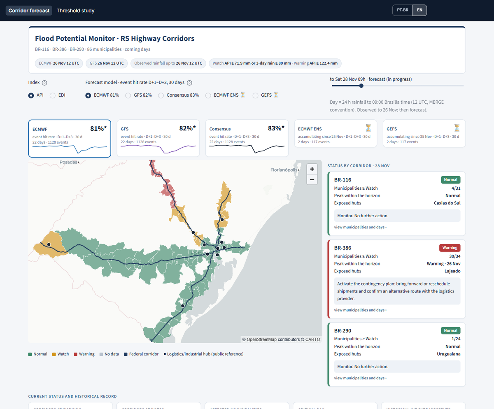
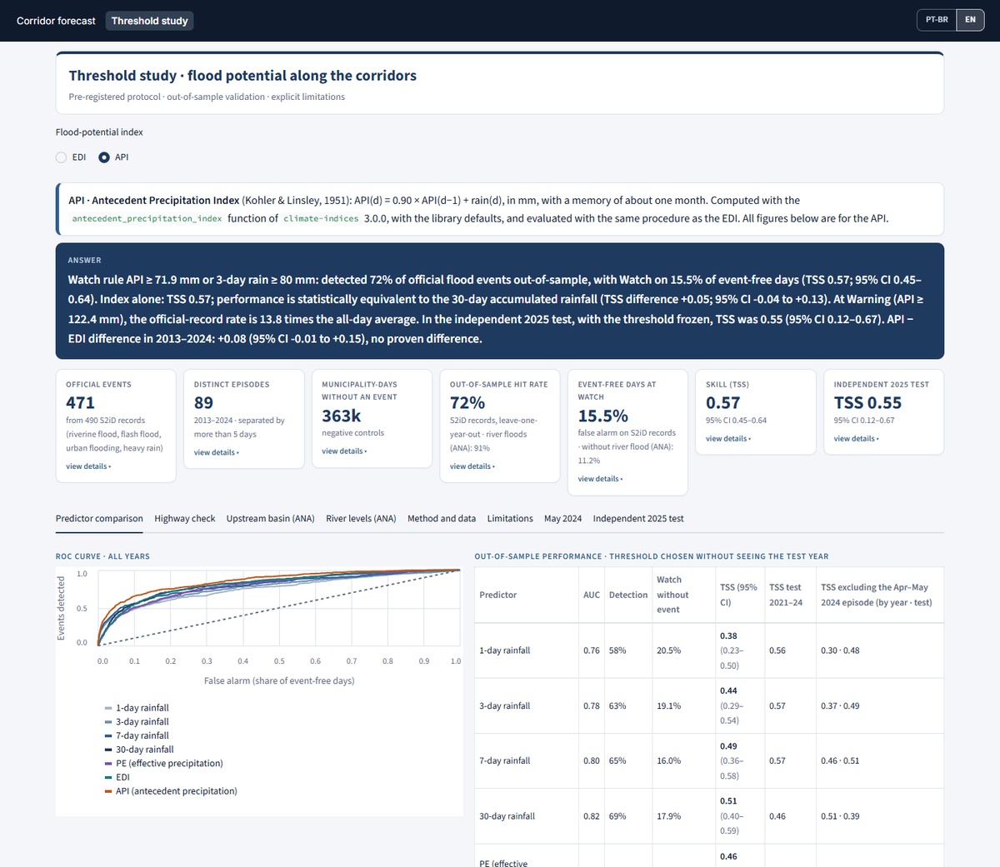
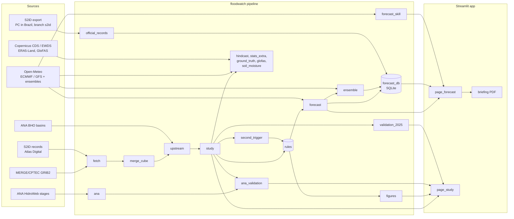

# RS Corridor Flood Watch

[](https://rs-corridor-flood-watch.streamlit.app/)
[](https://doi.org/10.5281/zenodo.24508671)

**Flood-potential early warning for the federal road corridors BR-116, BR-386 and BR-290 in Rio Grande do Sul, Brazil.
Two antecedent-rainfall indices (EDI and API) are calibrated on official disaster records, validated out of sample and
against gauged river floods, then applied every day to ECMWF and GFS forecasts.**

### ▶ Interactive dashboard: **[rs-corridor-flood-watch.streamlit.app](https://rs-corridor-flood-watch.streamlit.app/)**

Updated every day at about 17:00 Brasília time. Portuguese by default, English at
[?lang=en](https://rs-corridor-flood-watch.streamlit.app/?lang=en).

[](https://rs-corridor-flood-watch.streamlit.app/)

The April–May 2024 floods cut the main road links of Rio Grande do Sul for weeks. Beyond the human toll, they disrupted
water, power, transport and the supply chains that depend on the state's highways. This project asks one operational
question:

> *Can a rainfall-based antecedent-wetness index tell, days ahead, when the municipalities along the main logistics
> corridors are in conditions that have historically produced flood records?*

The answer is a cautious yes, with explicit limits. Every threshold was chosen on data the test never saw, every
headline number carries a 95 % confidence interval, and every decision taken after seeing a result is logged in
[docs/protocol.md](docs/protocol.md).

---

## Contents

1. [Key results](#key-results)
2. [Dashboard](#dashboard)
3. [Scientific method](#scientific-method)
4. [Software architecture](#software-architecture)
5. [Run it](#run-it)
6. [Limitations](#limitations)
7. [Data sources and licence](#data-sources-and-licence)
8. [How to cite](#how-to-cite)

---

## Key results

All numbers use **observed** rainfall (MERGE/CPTEC). Unit = municipality-day in the 86 corridor municipalities,
2013–2024. Events = **471** official flood events (490 S2iD records, 89 independent episodes); controls = 362,614
municipality-days without an event. TSS (Peirce skill score) = detection − false-alarm rate; 0 = no skill, 1 = perfect.

### Out-of-sample skill (leave-one-year-out, thresholds fitted without the tested year)

| Rule | AUC | Detection | False alarm¹ | TSS (95 % CI) | Train 2013–20 → test 2021–24 |
|---|---|---|---|---|---|
| **API, dashboard rule** (API ≥ 71.9 mm **or** 3-day rain ≥ 80 mm) | 0.86 | 72 % | 15.5 % | **0.57** (0.45–0.64) | 0.59 |
| **EDI, dashboard rule** (EDI ≥ 1.26 **or** 3-day rain ≥ 61 mm) | 0.82 | 75 % | 23.4 % | **0.52** (0.42–0.59) | 0.52 |
| EDI alone | 0.82 | 71 % | 21.8 % | 0.49 (0.38–0.57) | 0.50 |
| 30-day accumulated rainfall (benchmark) | 0.82 | 69 % | 17.9 % | 0.51 (0.40–0.59) | 0.46 |
| 3-day accumulated rainfall (benchmark) | 0.78 | 63 % | 19.1 % | 0.44 (0.29–0.54) | 0.57 |

¹ Share of event-free municipality-days on which the level was at Watch or above.

- **Warning level** (index above the value exceeded on only 2 % of event-free days): the flood-record rate is
  **13.8×** the all-day average for the API (≥ 122.4 mm) and **7.6×** for the EDI (≥ 3.16).
- **API vs EDI:** +0.08 TSS for the indices alone (95 % CI −0.01 to +0.15) and +0.05 for the dashboard rules (−0.03 to
  +0.11). The API is ahead but the gain is **not proven** on the official records. Against gauged river floods it
  **is**: +0.14 (+0.07 to +0.23).
- **Indices vs plain rainfall:** neither index beats 30-day rainfall with statistical confidence (API +0.05, CI −0.04 to
  +0.13; EDI −0.02, CI −0.11 to +0.05). This is reported as a result, not hidden.
- **3-day trigger:** adding "or 3-day basin rain ≥ b" improves the EDI (+0.03, CI +0.007 to +0.06, leave-one-year-out)
  and makes a negligible difference for the API. It is part of the dashboard rule for both.
- **Upstream-basin rainfall vs rainfall over the municipality:** equivalent on the official records (EDI −0.01,
  API +0.01, both CIs include 0) and slightly better against river floods. Basin rainfall is used because it is the
  rainfall that fills the rivers, not because it was proven better.

### Independent tests (thresholds frozen, nothing re-tuned)

| Test | EDI | API |
|---|---|---|
| **2025 records** (68 events, 12 episodes; a year no stage of the study used) | TSS 0.23 (0.03–0.55), detection 37 % | TSS 0.55 (0.12–0.67), detection 69 % |
| **Gauged river floods**, ANA (32 gauges, 25 municipalities, 257 events), dashboard rule | detection 91 %, false alarm 19.1 %, TSS 0.72 | detection 91 %, false alarm 11.2 %, TSS 0.80 |
| **Documented road impacts** on the three highways (16 evaluated) | 16/16 at Watch or above on D−2…D, 9 at Warning | 16/16 at Watch or above, 12 at Warning |

The pre-registered 2025 criterion (lower CI bound of TSS above 0.2) was **not met by either index**. Most 2025 events
came from the June flood, which followed a drought: the 365-day memory of the EDI was still low when intense rain
arrived, while the API (about one month of memory) reacted faster.

### Supplementary checks (registered 2026-11-24, protocol §§9.9–9.10)

| Check | EDI | API |
|---|---|---|
| **SEDI** (extremal dependence, suited to rare events), dashboard rule, leave-one-year-out | 0.68 (0.57–0.75) | 0.73 (0.61–0.80) |
| **Relative economic value**: cost/loss ratios with value > 0, Watch level | 0.04 %–0.4 % | 0.04 %–0.6 % |
| … Warning level | 0.1 %–1 % | 0.09 %–2 % |
| **PRF accidents with water on the road** (2021–2025, 153 municipality-days): share at Watch or above vs all days | 30 % vs 23 % (rate ratio 1.3) | 22 % vs 15 % (rate ratio 1.4; 2.3 at Warning) |
| **Corridor display rule** (20 %) vs corridor-days with such an accident: TSS | 0.13 | 0.16 |

- SEDI ranks the rules as the TSS does (30-day rainfall 0.67): the conclusions do not depend on the score.
- Flood records occur on 0.13 % of municipality-days, so Watch fires far more often than floods happen: it pays off
  only for very cheap actions (cost under ~0.6 % of the avoided loss); costly ones (re-routing a fleet) should use
  Warning.
- With 89 episodes the study detects TSS differences of about **0.10–0.12** or more (80 % power). The API − EDI rule (+0.05)
  and index − 30-day rainfall (+0.05) differences are below that: "not proven" means the sample is too small, not that
  the rules are equal.
- Water-on-the-road accidents are only weakly linked to the flood-potential levels: they follow the day's heavy rain
  (aquaplaning) more than flooding. The corridor display rule is weak against them.
- Copernicus EMS rapid mapping (May 2024, EMSR720) covered five areas in the Taquari–Antas valleys, none in a corridor
  municipality: not informative. Cemaden occurrences are not open data.

### Forecast rainfall

Archived runs, March 2024 → November 2026, 34 boxes of 0.5° over the corridors. ECMWF IFS forecast heavy rain
(≥ 20 mm/day, D+1 to D+3) better than NOAA GFS: equitable threat score 0.345 vs 0.286 (difference +0.059, 95 % CI
+0.026 to +0.093). Both underestimated 3-day rain on flood-record days (ECMWF 69 %, GFS 61 % of the observed amount at
D+1).

### Levels computed with forecast rainfall: hindcast (protocol §9.5–9.6)

Frozen dashboard rules applied to past ECMWF IFS and GFS runs (Open-Meteo previous-runs archive, 0.5° grid), every day
of March 2024 – December 2025, scored against the official records (170 events, 20 episodes). *Observed* = the same
rule with MERGE rainfall on the same days; TSS of Watch or above.

| Rule | Observed rain | ECMWF D+1 | D+3 | D+5 | GFS D+1 | D+3 | D+5 | Loss, mean D+1…D+3 (95 % CI) |
|---|---|---|---|---|---|---|---|---|
| **API** | 0.60 | 0.47 | 0.46 | 0.52 | 0.40 | 0.27 | 0.25 | ECMWF −0.13 (−0.21 to −0.05); GFS −0.28 (−0.33 to −0.14) |
| **EDI** | 0.46 | 0.35 | 0.34 | 0.38 | 0.33 | 0.21 | 0.17 | ECMWF −0.12 (−0.17 to −0.07); GFS −0.19 (−0.22 to −0.11) |

- **Forecast levels keep most of the skill with ECMWF and lose about half with GFS.** With ECMWF the API rule still
  scores TSS ≈ 0.46–0.52 up to D+5 (detection 61–68 %, false alarms 14–16 %). GFS loses skill quickly after D+1. The
  ranking is the same as for heavy-rain forecasts above, and it holds in 2024 and in 2025 separately.
- **The loss comes from missed events, not extra alarms:** false-alarm rates stay close to the observed-rain rule; detection drops
  because both models underestimate the heaviest rain.
- **ECMWF D+5 scoring slightly above D+1 is not meaningful:** 20 episodes, and the differences between leads are well
  within the uncertainty.
- **Bias correction (§9.6), quantile mapping fitted on 2024 and tested on 2025, does not help:** TSS change −0.006 (API,
  ECMWF; CI −0.06 to +0.01), −0.011 (API, GFS), −0.025 (EDI, ECMWF; CI −0.04 to −0.006), −0.019 (EDI, GFS). Not
  adopted. Mapping the whole distribution does not fix the missing extremes that drive the misses.
- Prospective verification of the operational forecasts continues on the dashboard; every run is archived
  (see [Forecast archive](#forecast-archive)).

### Soil moisture (protocol §9.11)

ERA5-Land soil moisture 0–100 cm over the same upstream basins, standardised per calendar day, leave-one-year-out on the
same 471 events:

| Rule | TSS (95 % CI) |
|---|---|
| API dashboard rule | 0.57 (0.46–0.64) |
| Soil-moisture anomaly alone | 0.39 (0.21–0.51) |
| API rule **or** (soil moisture ≥ s **and** day rain ≥ q) | 0.56 (0.45–0.64) |

Soil moisture alone is worse than the API (−0.18, CI −0.29 to −0.10), and adding it to the rule changes nothing
(−0.003, CI −0.008 to +0.003). **Negative result:** the API already carries the wetness memory that soil moisture
would add. (A defect found after the first run, which dropped basins partly over lagoons, was fixed and is logged; both
runs were negative.)

### River discharge: GloFAS benchmark (protocol §9.8)

GloFAS v4.0 reanalysis daily river discharge 1999–2025 (Copernicus EWDS), at each municipality's main-river cell
(0.05°), divided by that cell's median annual maximum 1999–2012, max of d−1 and d; threshold fitted exactly as the rules
(leave-one-year-out, maximum TSS), on the same samples as the API rule (358,854 municipality-days, 463 events).

| Design | GloFAS rule TSS | API rule TSS | API − GloFAS (95 % CI) |
|---|---|---|---|
| **Leave-one-year-out 2013–2024 (primary)** | 0.51 (0.40–0.59) | 0.56 (0.45–0.63) | **+0.05 (−0.01 to +0.10)** |
| Holdout: fit 2013–2020, test 2021–2024 | 0.61 (0.40–0.70) | 0.59 (0.31–0.69) | −0.02 (−0.10 to +0.02) |
| 2025 test, frozen thresholds (67 events, descriptive) | 0.33 | 0.56 | — |

- **River discharge does not beat the rainfall rule.** In the primary design both detect 72 % of the events; the API
  rule raises fewer alarms on days without one (16 % vs 21 %). The difference is not conclusive in either direction,
  and on 2025 the API rule is clearly better (detection 70 % vs 57 %). AUC 0.84 (GloFAS) vs 0.86 (API).
- The GloFAS threshold is about 0.26–0.31 of the median annual maximum discharge of the main river.
- GloFAS reanalysis is forced by observed weather, so this is compared with the observed-rainfall study, not with the
  forecast levels. Esteio (27 km²) contains no GloFAS cell centre and is left out (8 events); 31 Dec 2024 is missing in
  the EWDS dataset (84 days without events).

### Registered analyses still open

| § | Question | Status |
|---|---|---|
| 9.7 | **Ensemble probabilities:** are P(Watch) and P(Warning) from ECMWF ENS (51 members) and GEFS (31) reliable? | archived every day since 2026-11-25 (no back-fill: Open-Meteo serves no past ensemble runs); monitored on the dashboard; evaluated after one year |

---

## Dashboard

Streamlit, two pages, Portuguese and English (`?lang=en`), light corporate theme, desktop and mobile layouts.

### Page 1 — Corridor forecast

From top to bottom:

- **Header badges:** model run times, last observed day and the rule in force (Watch / Warning thresholds and 3-day
  trigger).
- **One filter bar:** flood-potential index (API first and default; EDI), weather model and day. The models are ECMWF,
  GFS, Consensus (the lower level of the two), ECMWF ENS and GEFS, each labelled with its event hit rate (CSI) at
  D+1–D+3 over the last 30 days, e.g. "ECMWF 81%", or ⏳ while it has fewer than 10 verified days; the 2024–2026
  heavy-rain hit rate is in the help tooltip. Each day is the 24 h window ending at 09:00 Brasília time (12 UTC).
- **Five accuracy cards** (the focus): event hit rate at D+1–D+3 over the last 30 days for each model, with detection
  and false alarms on one line (same window and n), verified days, events and a daily sparkline; * marks a small
  sample (< 30 days), ⏳ "accumulating since <date>".
- **Map** (pydeck) with the municipality levels for the selected day, the three highways and public logistics
  references, next to the **status by corridor** cards (municipalities at Watch or Warning, recommended action). With
  an ensemble selected, the map, timeline and alert feed show the level reached with P ≥ 0.5 and its probability
  ("Watch 70%"), the municipality details show the member mean and 90th percentile of the rain, and a note says where
  the ensemble horizon (D+7) is shorter than the deterministic one.
- **Current status and historical record:** KPI cards that open on click (corridors at Warning and at Watch, affected
  municipalities, critical day, historical hit rate) and the record with observed rainfall (S2iD 2013–2024 out of
  sample, 2025 test, river floods); then the **timeline** (corridor × day, ECMWF, GFS and the selected ensemble) and
  the **alert feed**, with *How to read* and the executive briefing.
- **Model accuracy in detail** (continuous monitoring): the daily event hit rate of the five models with the selected
  model highlighted, a window selector (last 30 days, the period common to all five models, each model's whole
  archive) and one sentence naming the best recent model (on the common period once every model has 10 days there).
  Collapsed below:
  - *Full table:* CSI, detection, false alarm ratio, rain bias and mean rain error at D+1, D+2 and D+3 with verified
    days and events; the ensemble Brier scores for P(Watch) and P(Warning); the 2024–2026 heavy-rain verification.
  - *How we calculate:* all five models are verified the same way (the forecast level vs the same rule on observed
    MERGE rainfall, on the same days, with the latest forecast issued before each day); the ensemble level is the
    highest level reached with probability ≥ 0.5 (fixed rule, [protocol §9.7](docs/protocol.md)) and ensemble rain is
    the member mean; grids; sample notes; provisional days (preliminary MERGE).
  - *Last verified day:* forecast vs observed rain per model, hits, and false alarms and misses by name.
  - *Official records* (S2iD "Danos informados" export, last 60 days of registrations, exported from a PC in Brazil
    about once a week; flood COBRADEs 12100, 12200, 12300, 13214; event date = the date in the protocol number):
    - records since the start of the forecast archive in RS and in the 86 corridor municipalities;
    - the median registration lag, with the latest days marked "records may still arrive";
    - every corridor record with the level of the rule on observed MERGE rainfall (API and EDI), the observed rain
      of the day and of 3 days and, when a forecast was archived, each model's level at D+1–D+3 (ensembles with
      P(Watch) / P(Warning)) and hit or missed; records before the archive show "no archived forecast". API cells
      issued before the API existed show the EDI, marked, and stay out of the API counts;
    - alarms without an official record or preliminary report within one day, per model, with a note that this
      share is naturally high and is not the false-alarm rate of the cards;
    - a collapsed list of all RS records (event and registration dates, COBRADE, in or out of a corridor).
- **Executive briefing (PDF, A4, two pages):**
  - *page 1:* how the models are verifying now (30-day hit rate of the five models), bottom line per corridor, map,
    municipalities to watch, logistics references, model agreement and reliability;
  - *page 2:* the coming days, one row per 24 h window, with ECMWF/GFS rainfall, corridor levels, municipalities at
    Warning and a rainfall chart.

### Page 2 — Threshold study



- **Answer banner** and KPI cards (events, controls, out-of-sample detection, false alarms, TSS, 2025 test), each with
  details. The index selector switches every number between EDI and API.
- **Tabs:**
  - *Predictor comparison:* ROC curves, the out-of-sample table and paired comparisons.
  - *Highway check:* documented road impacts.
  - *Upstream basin (ANA):* municipal vs basin rainfall.
  - *River levels (ANA):* the same rule against S2iD records and against river floods.
  - *Method and data*, *Limitations*, *May 2024* timeline, *Independent 2025 test* (including the second-trigger test).

---

## Scientific method

The full, consolidated protocol with the decision log is in [docs/protocol.md](docs/protocol.md). Summary:

### Data

| Input | Source | Use |
|---|---|---|
| Daily rainfall | MERGE/CPTEC-INPE, 0.1°, V07B final 1998–2024; IMERG late/early afterwards (product version checked per day) | Indices and accumulations |
| Flood events | S2iD records compiled in the Atlas Digital de Desastres no Brasil (MIDR/CEPED-UFSC, DB v1.1), COBRADE 12100, 12200, 12300, 13214 | Calibration and validation |
| Basins | ANA Otto-coded basins (BHO 2017, level 6) | Upstream-basin rainfall |
| River stages | ANA HidroWeb | Independent validation and river-state predictor |
| Roads, municipalities | DNIT SNV 2024, IBGE | Corridor municipalities (≥ 0.5 km of road) |
| Forecast | ECMWF IFS and NOAA GFS 12 UTC deterministic runs via Open-Meteo (CC BY 4.0); 06/00 UTC run if 12 UTC is missing | Daily forecast |
| Ensemble forecast | ECMWF ENS (51 members) and NOAA GEFS (31) via Open-Meteo | Archived probabilities (§9.7) |
| Recent flood reports | S2iD "Danos informados" report (exported weekly from Brazil) | Forecast verification |
| Road accidents | PRF open data, accidents with water on the road 2021–2025 | Independent check (§9.9) |
| Satellite flood maps | Copernicus EMS rapid mapping EMSR720 | Independent check (§9.9) |
| River discharge | GloFAS v4.0 reanalysis, Copernicus EWDS | Benchmark (§9.8) |
| Soil moisture | ERA5-Land daily statistics, Copernicus CDS | Extra predictor (§9.11) |

### Unit: the upstream basin

A river rises with the rain over its whole basin, not only over the municipality. For each municipality the rainfall
is the area-weighted mean over the level-6 Otto-coded basins with ≥ 5 km² inside it, plus every basin upstream of them
(Pfafstetter rule: a basin is upstream if its code is greater and shares the prefix up to the last even digit).
Coastal and lagoon codes (all digits odd) have nothing upstream but themselves. A day is valid only when ≥ 99 % of
the area has data.

### Indices (official library implementations, no adaptation)

- **EDI**, Effective Drought Index (Byun & Wilhite, 1999): effective precipitation over 365 days, standardised per
  calendar day with calibration fixed to 1999–2012 (disjoint from the evaluation years). `climate-indices` 3.0.0
  `effective_precipitation` + `edi`, library defaults.
- **API**, Antecedent Precipitation Index (Kohler & Linsley, 1951): `API(d) = 0.90 · API(d−1) + P(d)`, in mm; rain
  from 7 days ago still weighs ~48 %, from 30 days ~4 %. `antecedent_precipitation_index`, zero seed, a missing day
  propagates as missing. k = 0.90 is within the range cited by the library (0.85–0.90).
- The index code refuses any other library version.

### Events and samples

- Records of one municipality within 7 days are chained into one event, dated by its first record. Events of any
  municipality chained with gaps of ≤ 5 days form an episode, the bootstrap unit.
- Controls are municipality-days more than 15 days away from any record.
- The predictor value on day d is the maximum of d−1 and d. This absorbs the 12–12 UTC rainfall window and ±1 day in
  the reported date.

### Threshold selection and validation

- **Watch** = the threshold that maximises TSS on the training years. **Warning** = the lowest value exceeded on at most
  2 % of event-free days.
- **Leave-one-year-out** (primary) and a **temporal holdout** (2013–2020 → 2021–2024).
- **Block bootstrap** for every confidence interval: positives resampled by episode, controls by year-month, 2,000
  replicates, fixed seed.
- **Paired comparisons:** a rule "improves" only if the whole 95 % CI of the paired TSS difference lies above 0.
- **Final thresholds** are refitted on all 2013–2024 years and frozen.

### Dashboard rule (`floodwatch/rules.py`)

| Level | Condition |
|---|---|
| Warning | index ≥ Warning threshold |
| Watch | index ≥ Watch threshold, **or** 3-day basin rainfall ≥ frozen trigger |
| Normal | otherwise |
| No data | index missing (never shown as Normal) |

A corridor takes the highest level present in at least 20 % of its municipalities on that day. This is a display
rule and was not validated.

### Rigour safeguards

- **Pre-registration:** each analysis (2025 test, model verification, upstream basin, rivers, second trigger, and
  §§9.5–9.11) was written into the protocol before it was run. Post-hoc decisions are labelled as such in the decision log.
- **No re-tuning on test data:** 2025, river floods and road impacts are only ever scored with frozen thresholds.
- **Negative results are published:** the indices do not beat 30-day rainfall with confidence, and the 2025 criterion
  was not met.
- **Provenance:** every download has a sibling `.http.json` (URL, time, size, SHA-256). The MERGE product version is
  checked per day, and only V07B final is used for 1998–2024.
- **Reproducibility:** pinned dependencies, fixed seeds, and a runbook that rebuilds every number from raw data.
- **One implementation of each rule:** statistics (`stats.py`), the operational rule (`rules.py`) and the GRIB reader
  (`merge_cube.read_grid`) each exist once, so the study, the forecast and the dashboard cannot drift apart.

---

## Software architecture



### Modules (`floodwatch/`)

| Module | Responsibility |
|---|---|
| `paths` | Every file location in one place |
| `fetch` | Downloads raw inputs (MERGE, Atlas, IBGE, DNIT) with provenance files |
| `merge_cube` | The single checked GRIB2 reader (variable, date, grid, origin, scan order, product state); area means; RS cube |
| `upstream` | Pfafstetter upstream masks, basin weights, basin rainfall (observed) and the forecast grids (0.25°, 632 points; 0.5°, 180 points for ensembles and hindcast) |
| `indices` | EDI, PE and API from `climate-indices` 3.0.0, with an explicit calendar and calibration |
| `stats` | Contingency scores, AUC, threshold search, folds, block bootstrap, paired differences |
| `study` | Units, events and samples; predictors; out-of-sample evaluation → `results.json` |
| `second_trigger` | Index OR 3-day rain rule, fitted per fold; frozen trigger → `second_trigger.json` |
| `rules` | The operational rule (Normal / Watch / Warning / No data) used by every consumer |
| `validation_2025` | Independent 2025 test with frozen thresholds |
| `ana`, `ana_validation` | HidroWeb download and daily stages; basin vs municipal; river-flood validation; river-state predictor |
| `figures` | Derived tables for the study page (ROC, risk multiplier, May-2024 timeline, leads, road check) |
| `forecast_skill` | ECMWF vs GFS verification against MERGE, pre-registered |
| `forecast` | Daily run: refresh MERGE, basin rainfall, ECMWF/GFS 12 UTC runs (06/00 UTC fallback, paced requests), apply the rules |
| `ensemble` | ECMWF ENS and GEFS member rainfall → per-municipality P(Watch), P(Warning), archived daily (§9.7) |
| `forecast_db` | SQLite archive of every run (schema in `sql/`), observed vs forecast verification views, `verification.json` |
| `verification_summary` | The same continuous verification for ECMWF, GFS, Consensus and the ensembles; `verification_daily.csv`; accuracy windows for the dashboard |
| `s2id_records` | S2iD export parsing (event date from the protocol, registration lag, corridor membership) and the official-records summary for the dashboard |
| `official_records` | Weekly check of the Atlas Digital download page for a new S2iD release (auto-loaded); S2iD "Danos informados" export; preliminary flood reports |
| `hindcast` | Past ECMWF/GFS runs 2024–2025 → levels by lead time (§9.5) and quantile-mapping bias correction (§9.6) |
| `stats_extra` | SEDI, relative economic value and minimum detectable differences (§9.10) |
| `ground_truth` | PRF accidents with water on the road and Copernicus EMS overlap (§9.9) |
| `glofas`, `soil_moisture` | Copernicus downloads (sequential, patient retries) and the §9.8 / §9.11 evaluations |
| `page_forecast`, `page_study`, `briefing`, `ui_theme`, `exposure` | Streamlit pages, the PDF briefing, the shared visual system and public logistics references |

### Data layout

```
data/raw/          spatial, road_impacts, reports, copernicus_ems, prf/provenance.json (in git);
                   merge, atlas, ana, forecast_api, s2id, prf zips, hindcast, era5land, glofas (downloaded, not in git)
data/processed/
  study/           results.json, second_trigger.json, validation_2025.json, upstream_results.json,
                   river_validation.json, river_predictor.json, stats_extra.json, ground_truth.json,
                   figure tables, units.geojson, basin rainfall; later hindcast.json, bias_correction.json,
                   glofas.json, soil_moisture.json
  forecast/        runs/<utc>/ (metadata.json, municipal_levels.csv, ensemble_levels.csv), latest.json,
                   verification.json, verification_daily.csv (per day, model, lead and index),
                   official_records.json (S2iD records vs the rule and the forecasts),
                   forecasts.sqlite (authoritative copy on the branch archive)
sql/               schema.sql (tables + verification views), validation.sql (ready-made queries)
docs/              protocol.md, runbook.md, data-sources.md
scripts/           daily_update.ps1 (run by the workflow), s2id_export.ps1 + install_s2id_task.ps1 (PC), keep_alive.py
tests/             focused tests for the rules behind the published numbers
CITATION.cff, .zenodo.json   citation metadata for GitHub and Zenodo
CHANGELOG.md       changes by version
```

### Forecast archive

Every daily run is ingested into SQLite (`runs`, `municipal`, `corridor`, `events`, and `ensemble` for the member
probabilities). Each run stores the rule it used
and the last observed days, so later runs verify earlier forecasts. The `verification` view pairs each forecast with
the observed value and with official records, once these are loaded. `sql/validation.sql` has the queries, and
`python -m floodwatch.forecast_db report` prints them. After each run, `forecast_db.write_summary` exports the comparison to
`data/processed/forecast/verification.json`, which is published with the run and shown on the forecast page. This is how
the levels computed from forecast rainfall are verified prospectively, from November 2026 onwards.

### Quality

- `pytest -q`: 54 tests, covering block bootstrap and scores, event chaining, the 12 UTC window, the rule and trigger,
  rule compatibility with older runs, the Pfafstetter upstream rule, basin means, GRIB cropping, EDI calibration, API
  recursion and missing days, forecast-verification counts, preliminary-report filtering, module reachability, the
  ensemble's shortened API series (identical to the full one), quantile mapping and the GloFAS day and longitude
  alignment; plus the operational paths of the daily job: Open-Meteo run selection and its 06/00 UTC fallback (fake
  responses), the catch-up dates, the SQLite archive writes, the verification pairing, the archive check, the continuous
  verification of the five models (windows, counts, provisional days, best model, sample notes, ensemble levels with API
  and EDI probabilities, Brier scores), the S2iD records (protocol date, registration lag, corridor membership,
  pre-archive records, alarms without a record), and both dashboard pages with every model, index and window (Streamlit
  `AppTest`, Portuguese and English). Tests never use the network.
- `ruff` lint and format clean (settings in `ruff.toml`; version pinned in `requirements-dev.txt` and
  `.pre-commit-config.yaml`). Tests and ruff run on every push and pull request (`.github/workflows/tests.yml`). External requests are paced, honour `Retry-After` and never retry aggressively.

---

## Run it

```bash
python -m venv .venv                                # Python 3.11
source .venv/Scripts/activate                       # Git Bash; Linux/macOS: source .venv/bin/activate;
                                                    # PowerShell: .venv\Scripts\Activate.ps1
pip install -r requirements.txt                     # app only
streamlit run app.py                                # uses the bundled processed results
```

- **Refresh the forecast:** `pip install -r requirements-pipeline.txt`, then `python -m floodwatch.forecast`. This
  updates MERGE for the last 14 days, fetches the latest ECMWF/GFS runs and applies the frozen rules.
- **Rebuild everything from raw data:** 18 steps, listed in [docs/runbook.md](docs/runbook.md).
- **Daily operation:** the GitHub Actions workflow `.github/workflows/daily-forecast.yml` runs the forecast every day
  (scheduled for 17:00 Brasília; GitHub often starts it hours later) and pushes the new run to `main`. The verification
  archive `forecasts.sqlite` lives on the branch `archive` (one force-pushed commit), not in the local folder; before
  each push it must pass `python -m floodwatch.forecast_db check` (SQLite integrity, no table loses rows), and the
  previous copy is kept for 30 days as a workflow artifact. Each run
  first reconstructs every missing day (up to 14), each from that day's 12 UTC model runs and the rainfall observed up
  to that day, so the verification has no gaps. It then archives the ensemble probabilities (about 20 min; a failure
  there never blocks the forecast). `scripts/install_daily_task.ps1` (Windows scheduled task) is the former local
  alternative; never run it alongside the workflow, since both would push to `main`.
- **S2iD reports:** S2iD blocks IP addresses outside Brazil, so the cloud runner cannot export them. A scheduled task on
  the project PC (`scripts/install_s2id_task.ps1`) runs `scripts/s2id_export.ps1` at logon and pushes the export to
  the branch `s2id`; every workflow run loads the latest one. Switching the PC on once a week is enough.
- **Supplementary analyses** (§§9.5–9.11; Copernicus data need a free ECMWF account in `~/.cdsapirc` and the dataset
  licences accepted): `python -m floodwatch.stats_extra`, `python -m floodwatch.ground_truth [download]`,
  `python -m floodwatch.hindcast download|evaluate|bias-correction`, `python -m floodwatch.glofas download|evaluate`,
  `python -m floodwatch.soil_moisture download|evaluate`. Downloads are resumable.
- **Tests:** `pip install -r requirements-dev.txt && pytest -q`; `ruff check . && ruff format --check .` for
  style (`pre-commit install` runs ruff on every commit).

---

## Limitations

- **Records are not measurements.** An S2iD record depends on the municipality requesting it. The absence of a record
  does not prove the absence of a flood.
- **The unit is the municipality, not the road kilometre.** A level does not forecast a road closure.
- **Short-duration floods after dry spells are underestimated** (June 2025), especially by the EDI.
- **The EDI calibration covers 14 years** (MERGE starts in 1998), shorter than the 30-year WMO standard.
- **Large episodes weigh heavily.** April–May 2024 concentrates many records; results without it are reported.
- **River floods are defined statistically** (median annual maximum), not by official flood stages. Conventional
  readings at 07:00 and 17:00 can miss the peak.
- **Levels computed with forecast rainfall are less skilful than the study numbers.** The hindcast (2024–2025, 20
  episodes) puts the API rule at TSS ≈ 0.47 with ECMWF and ≈ 0.27–0.40 with GFS, against 0.60 with observed rain on the
  same days; both models miss the heaviest rain. Prefer ECMWF; GFS beyond D+1 is weak.
- **The ensemble verification is still short.** ECMWF ENS and GEFS are archived from 25 November 2026 only (no
  back-fill possible); the dashboard shows them as continuous monitoring, and their registered evaluation (§9.7) comes
  after one full year.
- **Recent S2iD reports depend on the PC in Brazil.** If it stays off, the "reported floods" card ages; the card shows
  the date of the last export.

This is an independent study, not an official warning. For warnings, follow Defesa Civil, CEMADEN and SGB.

---

## Data sources and licence

Code: MIT (see [LICENSE](LICENSE)). Data belong to their providers and keep their own terms. Details and references
are in [docs/data-sources.md](docs/data-sources.md). Sources: MERGE/CPTEC-INPE, Atlas Digital de Desastres no Brasil
(MIDR/CEPED-UFSC), S2iD, ANA (BHO, HidroWeb), IBGE, DNIT SNV, PRF open data, Open-Meteo (CC BY 4.0), ECMWF open data
(CC BY 4.0), NOAA GFS/GEFS, Copernicus Climate Change Service (ERA5-Land) and Copernicus Emergency Management Service
(GloFAS, EMS rapid mapping), and the basemap © OpenStreetMap contributors © CARTO.

**References.**
- Byun, H.-R. & Wilhite, D. A. (1999). Objective quantification of drought severity and duration. *Journal of Climate*, 12, 2747–2756.
- Kohler, M. A. & Linsley, R. K. (1951). *Predicting the runoff from storm rainfall.* U.S. Weather Bureau, Research Paper 34.
- Peirce, C. S. (1884). The numerical measure of the success of predictions. *Science*, 4, 453–454.
- Ferro, C. A. T. & Stephenson, D. B. (2011). Extremal dependence indices: improved verification measures for
  deterministic forecasts of rare binary events. *Weather and Forecasting*, 26, 699–713.
- Richardson, D. S. (2000). Skill and relative economic value of the ECMWF ensemble prediction system. *Quarterly
  Journal of the Royal Meteorological Society*, 126, 649–667.

---

## How to cite

Andrade, V. *RS Corridor Flood Watch: flood-potential thresholds (EDI, API) for the BR-116, BR-386 and BR-290
corridors, Rio Grande do Sul, Brazil.* Zenodo. [doi:10.5281/zenodo.24508671](https://doi.org/10.5281/zenodo.24508671)
(this DOI always resolves to the latest version). Metadata in [CITATION.cff](CITATION.cff); GitHub's *Cite this
repository* button uses it.
